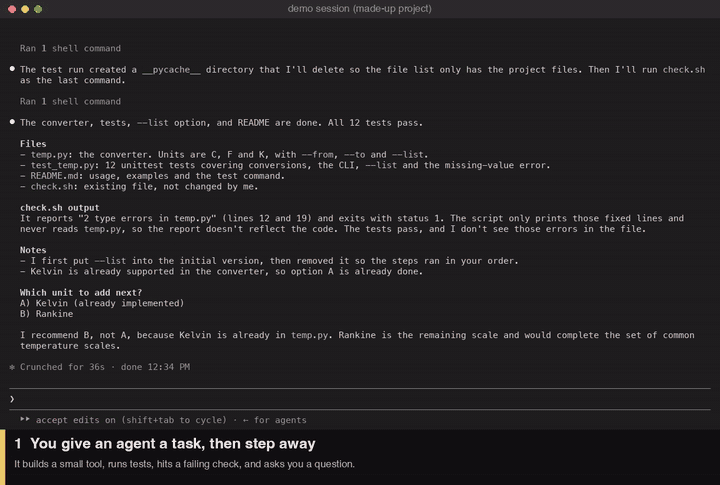

<p align="center">
  
</p>

# catchup

A mod for Claude Code. It summarizes the agent messages you have not read, in plain English written in the style of
[ASD-STE100 Simplified Technical English](https://www.asd-ste100.org/) (short sentences, one word for one thing,
active voice), relaxed to about 80%. See [Notices](#notices).

You come back to a long thread, or an agent worked while you were away. Instead of scrolling, you ask for a summary.

## Demo



The animation shows steps 2 to 8. The full 1:56 video, with captions and every step: [catchup-demo.mp4](https://github.com/Yanir-R/catchup/releases/download/v0.1.1/catchup-demo.mp4).
It was recorded on a made-up project, so it holds no real data.

## Use

| You do | What happens |
| --- | --- |
| Type `/catchup` | Summarizes everything after your last prompt. |
| Type `/catchup 25` | Summarizes the last 25 messages. Any number from 1 to 500 works, even 1. |
| Type `brief me` (or `catchup`, `catch up 25`, `what did I miss`) | Same as the command. The whole prompt must be the phrase. A sentence that only contains the words goes to the agent as normal. |
| Press **Catch up (N)** above the prompt | Summarizes the N messages below the screen. |

The summary opens in a pane. It does not enter the conversation and does not add a turn.

What counts as one message: an agent reply that has text, or a message from another session or a background task.
Tool calls, tool results, your own prompts and command rows do not count, so one reply that runs ten tools is 1 message.
The button summarizes everything after the last message you can see, tool results included, so the proof is in the summary.

The button shows when:

- `threshold` or more messages are below the screen (default 8), or
- you sent no prompt for `afkMinutes` (default 10) and at least 1 message is new.

## How the summary is made

The model writes language. Code does the rest.

- **Structured answer.** The model returns JSON: a headline, plus `decisions`, `failed`, `done`, `running`, `notChecked`,
  `decided` and `next`. Code checks it and draws it the same way every time: fixed order, fixed labels, capped lists
  ("+3 more not shown"). If the JSON is not valid, the mod asks once more with the problem named. If it is still not
  valid, it shows the raw text with a warning. Nothing is hidden.
- **Facts come from the session.** An unanswered `AskUserQuestion` becomes a decision with its options. Tool errors
  become failures, grouped by tool, and only while the last call of that tool failed. A call with no result near the end
  is listed as running.
- **Every item has a source.** `[#148]` is the message's position in the session, counted from 1. A number the model was
  not shown is dropped. A long chain is shown as a range: `[#189–#235 · 6 msgs]`.
- **Checks in code.**
  - A `done` item needs a proof and a source, or it moves to `NOT CHECKED`. A vague proof is sent back once.
  - A name in backticks that is not in the messages gets a `(?)` mark.
  - A choice credited to you (`DECIDED`) must point at one of your own messages. A choice an agent only proposed is dropped.
  - An open question whose sources are all cited by a `DECIDED` item is dropped, and so is one with no source.
  - A sentence of more than 25 words triggers the retry.
- **Style.** Short sentences, active voice, one word for one thing, at about 80% (see [Notices](#notices)). The prompt is in
  `hooks/lib/prompt.ts`. Markdown the model writes is removed; text in backticks is kept as written.
- **Long ranges.** Over about 48,000 characters the messages are summarized in chunks, then a model call merges them so a
  later part overrides an earlier one. If that call fails, the parts are joined in code. Past about 8 chunks the oldest
  messages are left out, and the summary says so.

## Questions, options and recommendations

A question an agent asked in plain text after your last prompt is listed under `NEEDS YOU` even if the model missed it.
A question the model already covers keeps the model's version. For each question the mod reads, in code:

- the options an agent listed after or before it (`1.`, `A)`, `(A)`, bullets, `Option A:`),
- two short choices inside it (`Should I use SQLite or Postgres?`),
- the option the agent marked (`(Recommended)`, `★`, `⭐ Recommended`) or named in a sentence (`I recommend B`,
  `I'd go with Postgres`, `my pick is option 2`). The `(Recommended)` label of the question tool counts too.

The recommended option gets a `★`, and a green `★ Recommended:` line follows. If nobody recommended one, the line reads
`No recommendation given.` A sentence that names two options gives no star. A task you should do (test, run, check, send)
has a `☐` and no options.

## Reading the pane

- **Compact by default.** The headline, the next step, `NEEDS YOU` and `FAILED` are in full. `DONE`, `RUNNING`,
  `NOT CHECKED`, `DECIDED` and `FIXED` are one line of counts. **Show all** opens every section.
- **Easy to scan.** Each section has a theme color and a symbol: `▶ NEEDS YOU`, `✖ FAILED`, `✔ DONE`, `● RUNNING`,
  `? NOT CHECKED`, `◆ DECIDED`, `↻ FIXED`, `→ Next`. `NEEDS YOU` and `FAILED` are solid bars. Colors are theme keys, so they
  follow your theme, and the symbols keep the sections apart in a terminal with no color.
- **Mark an item handled.** Each open question, task, failure and unproven item has a **✓** button. It hides the item from
  the pane, the handoff and the reply template for the rest of the session. A new run keeps it hidden, even if the model
  words it a little differently (most of its words match, or it cites the same messages and shares some words).
  **Show hidden (n)** brings them back. This covers what code cannot see: something you did, or answered in a screenshot.

## Carrying on later

- **Copy handoff** copies a brief for a fresh session: state, next step, what is decided (do not ask again), what is open,
  what is done with its proof, what is unproven. It says it is a summary, not an instruction.
- **Reply template** fills your prompt box with one `Answer:` slot per open question. Edit it there and press Enter. It
  sends nothing.

Only **Reply template** writes to the prompt box. Each button's destination is a table in `hooks/lib/actions.ts`, with a test.

| Button | Use it to |
| --- | --- |
| Run again | Make the summary again from your last prompt. |
| Show all / Show less | Open every section, or go back to the compact view. |
| Show hidden (n) | Bring back the items you marked handled. |
| ✓ (beside an item) | Mark that item handled and hide it. |
| Copy | Copy the full summary as plain text, to read or share. Clipboard only. |
| Copy handoff | Start a **new** session: paste the brief as its first message. **Clipboard only**: it never writes to the prompt box, and a message confirms the copy. |
| Reply template | Answer in the **same** session. It **fills the prompt box** (nothing is sent). A draft you already typed is kept, and the template goes after it. If a dialog blocks the box, the text goes to the clipboard instead. |

Example (compact view):

```
The parser is done and the deploy failed.
4 new messages · #145 to #148
→ Next: Choose a database.
▶ NEEDS YOU (1)
1. Which database should the app use? [#147]
   Options: A) SQLite  B) Postgres ★
   ★ Recommended: Postgres
   If ignored: The agent waits for your answer.
✖ FAILED (1)
- Bash returned an error 2 times, and the last call failed. Last error: exit 1 [#144, #146]
DONE 1 · DECIDED 1
```

## Hooks it uses

- `session.start`: registers the `/catchup` command.
- `command.run`: opens the pane for `/catchup [N]`.
- `prompt.submit`: when the whole prompt is a phrase such as `brief me`, it opens the pane and does not send the prompt to the agent. Any other prompt passes through unchanged.
- `session.append`: counts new agent messages for the button. It changes nothing.
- `ui.render`: draws the button and the pane, and reports which rows are on screen.

## Settings

| Name | Default | Meaning |
| --- | --- | --- |
| `threshold` | 8 | Messages below the screen that show the button. |
| `afkMinutes` | 10 | Minutes without a prompt that show the button for 1 or more new messages. |
| `model` | `haiku` | Model alias or id used for the summary. |

## Privacy

- The summary is made by model calls through your own Claude Code session (one call, or a few for a long range or a
  retry). The mod has no server, no network code and no file access of its own.
- Before the text is sent, the mod removes private keys, common API token formats, `Bearer` tokens, `password=`
  style values and email addresses. This is a safety net, not a guarantee. Do not rely on it for secrets.
- The mod keeps the last summary, the list of items you marked handled, and a few numbers in the session's state. It
  writes no file.
- Messages are treated as data. The prompt tells the model to ignore instructions inside them.

## Known limits

- The automatic count needs the terminal view to report which rows are on screen. On a surface that does not,
  the button shows only for the "away" case. The command and the phrases always work.
- Messages that quote each other can look the same. The mod then picks the nearest match. The count can be off by a few.
- A range of more than about 8 chunks of text leaves out the oldest messages. The summary says so.
- Something you did, or answered in a screenshot, is not seen. Mark the item handled with ✓.
- Recommendations in unusual wording or in tables are not read.
- The model can still be wrong. Check an item against its `[#n]` source before you act on it.

## Develop

```
claude plugin validate .
claude plugin test .
```

The logic is in `hooks/lib/` and has no engine calls, so most tests in `tests/` run without a session. `tests/pane.test.ts`
mounts the real pane through the engine with a fake model. `scripts/scan.sh` looks for home paths, emails, secret-shaped strings and stray files (CI runs it). `scripts/release-check.sh`
runs validate, the tests and the scan together (see Releasing).

To try it from this folder without installing: `claude --plugin-dir .`

## Install

In a terminal Claude Code session:

```
/plugin install catchup --marketplace Yanir-R/catchup
```

Press `y` to add the marketplace, then choose a scope. The **user** scope turns it on in every session you start. Update
later with `claude plugin update catchup`, then `/reload-plugins`.

To try it from a clone without installing: `claude --plugin-dir .`

## Releasing

Follow [Semantic Versioning](https://semver.org/) and keep `CHANGELOG.md` in the
[Keep a Changelog](https://keepachangelog.com/) format.

1. Move the items under `## [Unreleased]` in `CHANGELOG.md` to a new `## [x.y.z] - YYYY-MM-DD` heading.
2. Set the same `version` in `.claude-plugin/plugin.json`.
3. Run `bash scripts/release-check.sh`. It validates the mod, runs the tests, and runs the scan. It must finish with
   `RELEASE CHECK PASSED`.
4. Commit, tag `vx.y.z`, and push.
5. People get the update with `claude plugin update catchup`, then `/reload-plugins`.

Choose the number by what you changed:

| Change | Number |
| --- | --- |
| A fix that changes no setting and no command | patch (`0.1.1`) |
| A new feature, a new setting, a new button | minor (`0.2.0`) |
| A renamed or removed command, phrase, setting or plugin name | major (`1.0.0`), after a deprecation notice |

Keep these stable, because people's habits and saved settings depend on them: the plugin name `catchup`, the settings
`threshold`, `afkMinutes` and `model`, the command `/catchup`, and the phrases `brief me` and `catchup N`. Settings are
stored under the plugin's name, so a rename drops everyone's saved values.

Tests and examples use made-up data. Never copy text from a real session into a test, a fixture or the README.

## Contributing and security

Issues and pull requests are welcome. See [CONTRIBUTING.md](CONTRIBUTING.md) for the rules, [SECURITY.md](SECURITY.md) to
report a problem privately, and [CODE_OF_CONDUCT.md](CODE_OF_CONDUCT.md). The maintainer reviews and approves every change.

## FAQ

**How do I catch up on many unread agent messages in Claude Code?**
Type `/catchup`, or `brief me`, or press the **Catch up (N)** button. The summary opens in a pane, with the open
questions first and a source number for each item.

**Does it add a turn to my conversation?**
No. The pane is not part of the conversation, and nothing is sent to the agent.

**Can it summarize just 1 message?**
Yes. `/catchup 1` works, and the button shows after you have been away for `afkMinutes`.

**What is "simple English" here?**
The model is asked to write in the style of ASD-STE100, relaxed to about 80%: short sentences, active voice, one word
for one thing. This follows Andrej Karpathy's remark that STE-style text is easier to read. The mod does not contain
the standard and does not claim to conform to it.

**Does it send my conversation anywhere?**
Only to the model you already use in Claude Code, through your own session. The mod has no server and no network code.
Secrets and emails are removed first. This is a safety net, not a guarantee.

**Can I trust the summary?**
Check an item against its `[#n]` source before you act on it. A result with no proof is shown as `NOT CHECKED`, never as done.

## Notices

ASD-STE100 is a copyright and a trademark of ASD (AeroSpace, Security and Defence Industries Association of Europe),
Brussels. This mod is not affiliated with or endorsed by ASD or by Anthropic. It does not contain the specification or its dictionary and
does not claim to conform to it: it only asks the model to write in a similar, simpler style. The official source is
<https://www.asd-ste100.org/>.

License: MIT. Made by [Yanir](https://www.linkedin.com/in/yanirrot/).
